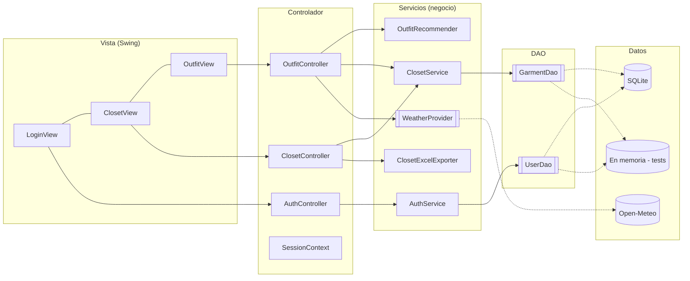
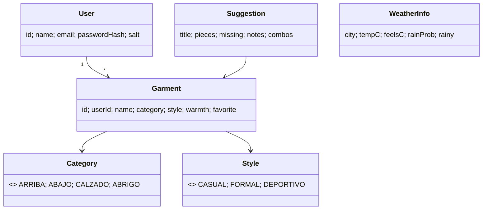

# Arquitectura de LookHoy

## 1. Vista general (MVC + DAO)

`[[ ]]` = interfaz. Las flechas punteadas son implementaciones concretas elegidas solo en `App.java`.

## 2. Modelo (clases principales)

## 3. Dónde se aplica cada principio

| Principio | Evidencia en el código |
|---|---|
| **MVC** | `view/` solo dibuja y captura eventos; `controller/` traduce eventos a casos de uso; `service/` + `model/` contienen la lógica y los datos. La vista nunca toca un DAO. |
| **DAO** | `UserDao` y `GarmentDao` (interfaces) con `SqliteUserDao`/`SqliteGarmentDao` (JDBC) e `InMemory*Dao` (pruebas). |
| **TDD** | `src/test/java`: se escribe la prueba del comportamiento (p. ej. "otra sugerencia da la vuelta", "nadie elimina prendas ajenas") y luego la implementación. DAO en memoria permiten probar servicios sin base de datos. |
| **S** – Responsabilidad única | `AuthService` (identidad), `ClosetService` (clóset), `OccasionStyleResolver` (ocasión→estilo), `OutfitRecommender` (puntaje), `ClosetExcelExporter` (Excel). |
| **O** – Abierto/cerrado | Nuevos proveedores de clima o nuevas reglas de ocasión se agregan sin tocar el recomendador. |
| **L** – Sustitución de Liskov | `InMemory*Dao` y `Sqlite*Dao` son intercambiables ante la misma interfaz (mismas pruebas de contrato). |
| **I** – Segregación de interfaces | `UserDao`, `GarmentDao` y `WeatherProvider` son pequeñas y específicas. |
| **D** – Inversión de dependencias | Servicios y controladores reciben interfaces por constructor; `App.java` es la única raíz de composición. |

## 4. Seguridad aplicada

| Riesgo | Medida | Dónde |
|---|---|---|
| Contraseñas expuestas | PBKDF2-HMAC-SHA256, 120 000 iteraciones, sal aleatoria de 16 bytes, comparación en tiempo constante | `PasswordHasher` |
| Contraseña en memoria | `char[]` limpiado tras usarse | `LoginView` |
| Enumeración de usuarios | Mismo mensaje para correo inexistente y clave incorrecta | `AuthService.login` |
| Inyección SQL | Solo `PreparedStatement` (hay prueba con `' OR '1'='1`) | `Sqlite*Dao` |
| Acceso a datos ajenos | Toda consulta filtra por `user_id` | `SqliteGarmentDao` |
| Entradas inválidas | Validación de correo, clave, ciudad y prenda | `InputValidator`, `Garment` |
| Inyección de fórmulas en Excel | Prefijo `'` en celdas que empiezan con `= + - @` | `ClosetExcelExporter` |
| Datos sensibles en logs | Se registra el id, nunca la contraseña | `AuthService` |
| Red | Solo HTTPS, con timeouts, fuera del hilo de la interfaz | `OpenMeteoWeatherProvider`, `OutfitView` |

## 5. Uso de librerías

| Librería | Uso concreto |
|---|---|
| Google Guava | `Preconditions` (validar `Garment`), `ImmutableList`, `Multimaps.index` (clóset por categoría) |
| Apache Commons | `commons-lang3` (`StringUtils`), `commons-codec` (`Hex` en el hash) |
| Apache POI | Exportación del clóset a `.xlsx` |
| Logback | `logback.xml` con consola y archivo rotativo `logs/lookhoy.log` |
| (apoyo) | JUnit 5, sqlite-jdbc, Gson |
